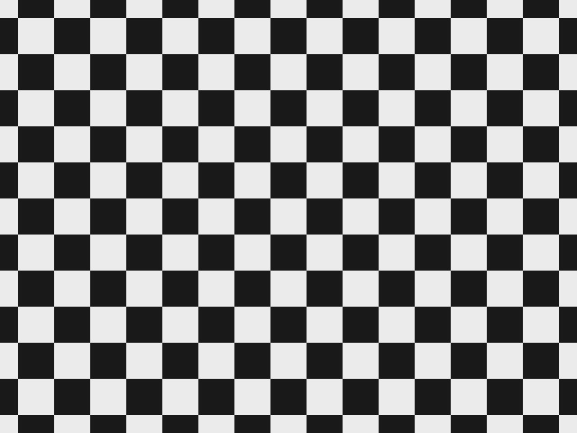
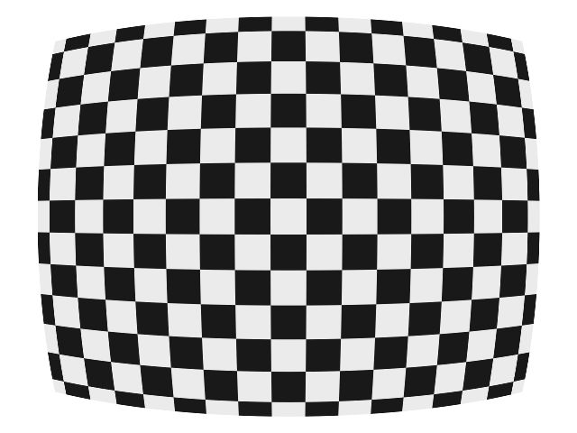
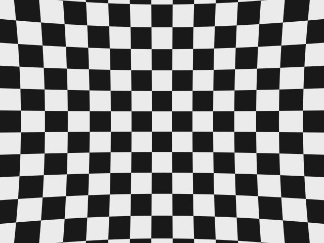
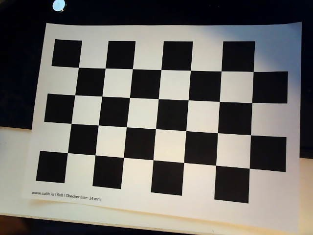
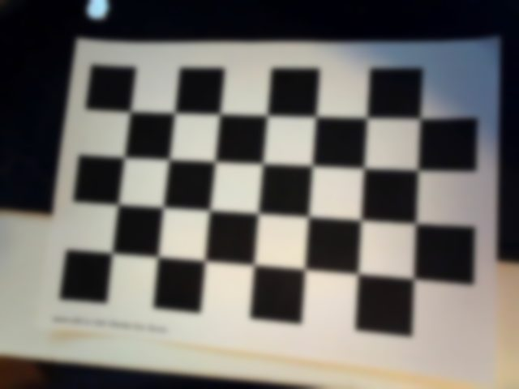
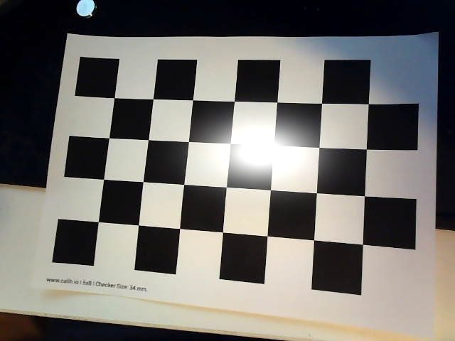
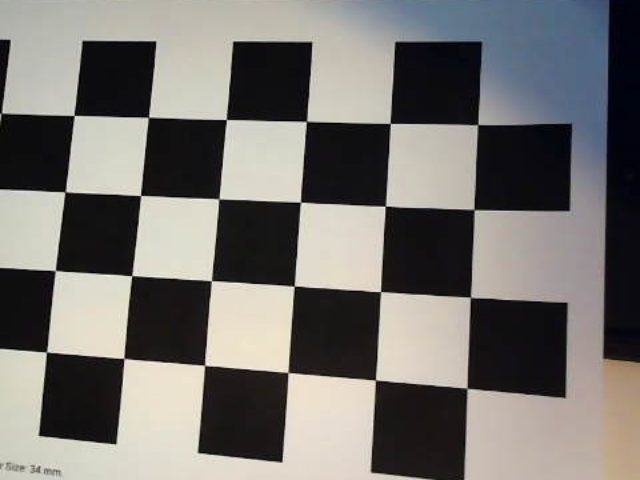
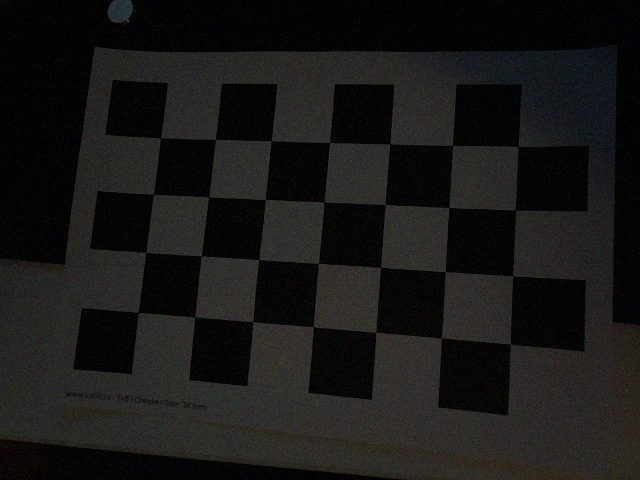
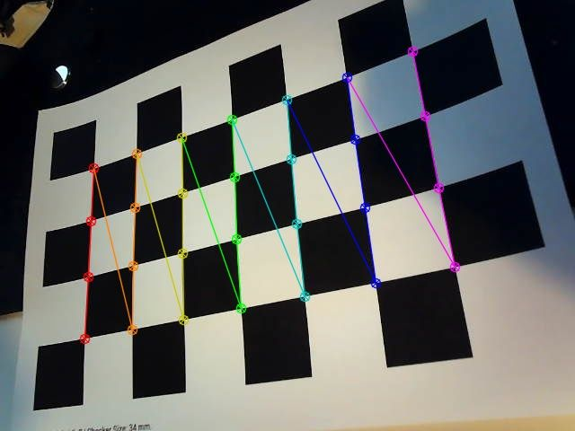
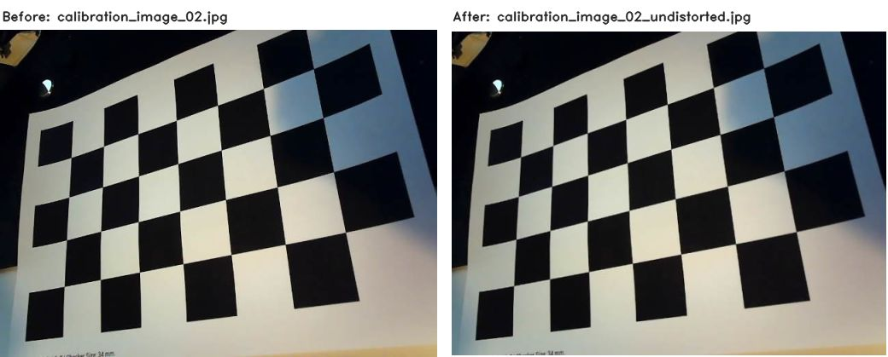

# Camera Calibration Tutorial

This tutorial provides scripts for capturing calibration images and performing camera calibration using OpenCV.

The same tutorial is also a web page, with interactive figures and real results from the HQ camera: [Week 7 lens calibration (web page)](https://dkaka.github.io/COMP0219_Tutorials/tutorials/week07_calibration/docs/). The page is in [`docs/`](docs/), and it is also on Moodle.

- `calibration_cap.py` captures photos of a chessboard. On the Raspberry Pi it uses the HQ camera through Picamera2. On a laptop it uses the webcam, which is only useful for practice.
- `calibration_gui.py` captures the same photos in a window with buttons, on the Raspberry Pi desktop. Before it saves a photo, it checks that the board is still and that `calibration.py` will find the board in the photo. It also shows which parts of the image still need photos.
- `calibration.py` calculates the camera matrix and the distortion coefficients from a folder of chessboard photos, or from a video of a chessboard. It runs on the Raspberry Pi and on a laptop.

## Why calibrate?

A real lens does not make a perfect image: it bends straight lines, and the effect is strongest near the edges and corners of the image. The calibration measures, for your camera and lens, the focal length, the centre of the image and the lens distortion. It does this with photos of a chessboard whose square size you know. With these values you can remove the distortion from your images, and you can measure positions and angles in the image correctly.

| No distortion | Barrel distortion | Pincushion distortion |
|:---:|:---:|:---:|
|  |  |  |
| Straight lines stay straight. | Straight lines bend outwards, away from the centre of the image. | Straight lines bend inwards, towards the centre of the image. |

These three pictures are synthetic: the same flat chessboard is drawn through a lens model without distortion, with barrel distortion and with pincushion distortion. In these pictures the distortion is much stronger than in the sample photos of this tutorial, so that you can see it easily.

## Installation

The setup is different on the Raspberry Pi and on a laptop.

### On the Raspberry Pi

There is nothing to install with pip for this tutorial. OpenCV and NumPy come from apt, and you use the `comp0219` environment that you created in Week 6 (section B of the Picamera2 tutorial, [`../week06_picamera2_tutorial/README.md`](../week06_picamera2_tutorial/README.md#b-set-up-the-python-environment-on-the-raspberry-pi)). That environment was made with `--system-site-packages`, so it can see the apt packages.

```bash
sudo apt install -y python3-opencv   # does nothing if OpenCV is already installed
source ~/comp0219/bin/activate
```

**Do not run `pip install -r requirements.txt` on the Raspberry Pi.** pip would install a second copy of OpenCV and NumPy 2 into the environment. Some parts of Picamera2 were built for the NumPy version from apt, so `from picamera2 import Picamera2` would then stop working.

To check the environment, run the following command. If it prints two version numbers and no error, the environment is correct.

```bash
python -c "from picamera2 import Picamera2; import cv2, numpy; print(cv2.__version__, numpy.__version__)"
```

### On a laptop (Windows, macOS or Linux)

On a laptop, create a normal virtual environment (without `--system-site-packages`) and install the packages in `requirements.txt` with pip. Run these commands in the `week07_calibration` folder. If you already have a `comp0219` environment on your laptop, you only need to activate it and run the `pip install` line.

macOS or Linux:

```bash
python3 -m venv comp0219
source comp0219/bin/activate
pip install -r requirements.txt
```

Windows PowerShell:

```powershell
py -m venv comp0219
comp0219\Scripts\Activate.ps1
pip install -r requirements.txt
```

Windows Command Prompt (cmd):

```bat
py -m venv comp0219
comp0219\Scripts\activate.bat
pip install -r requirements.txt
```

If Windows does not find the `py` command, use `python` instead. If PowerShell says that running scripts is disabled on this system, use the Command Prompt commands instead.

`requirements.txt` installs NumPy and one OpenCV package (`opencv-python`, version 4.8 or newer but below 5).

## Project Structure

```
week07_calibration/
├── calibration_cap.py              # Script for capturing calibration images
├── calibration_gui.py              # The same, in a window with buttons (Raspberry Pi desktop)
├── calibration.py                  # Script for camera calibration
├── calibration_data.npz            # Reference result for the sample images
├── chessboard_5x8_34mm_A4.pdf      # The chessboard to print (A4, 34 mm squares)
├── docs/                           # The same tutorial as a web page with widgets (for Moodle)
├── img/                            # The figures of this README
├── sample_calibration_images/      # 6 sample images (640x480 pixels) for testing
├── requirements.txt                # Python packages for a laptop (not for the Pi)
└── README.md                       # This file
```

The scripts create two more folders next to themselves. `calibration_cap.py` and `calibration_gui.py` save your photos in `calibration_images/`, and `calibration.py` writes its results to `calibration_output/`.

## Usage

**A calibration is only valid for one image size, one sensor mode and one focus setting.** The sensor mode is the way the camera reads out its sensor (for example the full sensor, or a binned or cropped part of it). For example, the 120 fps mode of the HQ camera uses only the central part of the sensor, so a calibration made in another mode is wrong for 120 fps videos. So capture the calibration photos with the same image size and the same sensor mode as your wind-tunnel videos, and do not turn the focus ring after you calibrate. If you change the size, the sensor mode or the focus, calibrate again.

### Before you start: a flat chessboard

The scripts are set up for a chessboard with **5 × 8 squares of 34 mm**. This board has **4 × 7 inner corners**. An inner corner is a point where four squares meet, and these points are what OpenCV finds. The sample photos show this board.

1. Print [`chessboard_5x8_34mm_A4.pdf`](chessboard_5x8_34mm_A4.pdf) on A4 paper. In the print dialog, choose "100 %" or "Actual size". Do not choose "Fit to page", because that makes the squares smaller.
2. Measure the line at the top of the sheet with a ruler. It must be 100 mm long. If it is not, measure the width of 5 squares, divide it by 5, and write the result into `square_size` in `calibration.py`. The square size does not change the camera matrix or the distortion coefficients. It changes only the distances in `tvecs`, which you need later when you measure positions in millimetres.
3. Fix the sheet flat on something stiff, for example a clipboard, a foam board or thick cardboard. Use glue, or tape along all four edges. The calculation assumes that all corners lie in one flat plane, so a bent or wavy sheet gives a wrong calibration.
4. Use matt paper. Glossy paper and laminated sheets reflect the lamps, and a reflection can hide corners.

You can also use a different chessboard. Then count its inner corners, set `chessboard_size` in both scripts, and set `square_size` to the size of one square.

### Step 1: Capture Calibration Images

There are two programs for taking the photos. Both save the photos in the same folder, `calibration_images/`, so you can use either of them, or both.

- `calibration_gui.py` opens a window with buttons on the Raspberry Pi desktop. It helps you most, so use it if you can (see the next section).
- `calibration_cap.py` works with keys. It also works without a desktop, for example over SSH or in the Pi Connect remote shell (terminal mode).

#### The capture window: `calibration_gui.py`

Run it in a terminal on the Raspberry Pi desktop (on the lab monitor, or in the screen sharing of Raspberry Pi Connect):

```bash
python calibration_gui.py
```

The window needs Tkinter, which comes with the desktop version of Raspberry Pi OS. If Python says that `tkinter` is missing, install it with `sudo apt install -y python3-tk`. SSH and the Pi Connect remote shell have no desktop, so there the program stops with a message. Use `calibration_cap.py` there instead.

Press **Start** to see the live picture of the camera. Then hold the board in front of the camera.

- The status line under the picture says what the program sees: "No chessboard", "hold still" or "ready". When it says "ready", press Space or the **Save photo** button.
- **Motion check** (on at the start): a photo is saved only after the board has been still for a moment (0.3 seconds), so that the photo is sharp. A hand that holds the board quietly is still enough. If you press Space while the board moves, the program saves nothing and tells you so. Untick **Motion check** to save without waiting. Then hold the board steady yourself, because a moving board gives a blurred photo.
- **Auto capture** (off at the start): tick it, and the program saves a photo by itself each time you hold the board still at a new position. Then you can hold the board with both hands. If the motion check is off, Auto capture saves each new position, at most once a second.
- Before it saves a photo, the program searches the full-size photo for the board in the same way as `calibration.py`. If this search fails, the photo is not saved, and the program says why this can happen. So `calibration.py` can use every photo that the window saves.
- The **Board positions** panel on the right shows each saved board in green. The parts of the image that no photo covers yet are red. The status line says how many of the nine parts of the image (3 × 3) still need photos, and after each photo the program names them. Hold the board in the red parts next, especially in the corners of the image. The green dots on the live picture are the corners in the photos so far.
- From 4 photos on, the window calibrates in the background and shows the focal length, the image centre, k1 and the RMS error so far. It uses the same settings as `calibration.py`, so `calibration.py` gives the same result for the same photos. The pixels of the camera are square, so fx and fy should be almost equal. If they differ by more than 10 %, the window says that the estimate is not reliable yet: the photos are too similar, for example all facing the camera, so add tilted photos and photos near the corners of the image. Tick **Undistorted view** to see the live picture corrected with this estimate. Lines that are straight in the scene should then look straight.
- **Undo last** (or the `u` key) deletes the last photo that you saved since you started the program. Press `q` or close the window to end the program. Ctrl+C in the terminal also closes it.

The window looks for the board in a small grey copy of each picture (640 × 480 pixels), which the camera makes at the same time as the full-size photo. This keeps the live picture fast. `CAPTURE_SIZE`, `SENSOR` and `CHESSBOARD_SIZE` at the top of `calibration_gui.py` work in the same way as `CAPTURE_SIZE`, `SENSOR` and `chessboard_size` in `calibration_cap.py` (see below). When you have enough photos, run `python calibration.py --images calibration_images` (Step 2).

#### The keyboard script: `calibration_cap.py`

Use `calibration_cap.py` to capture images of a chessboard pattern from different angles and distances. Run it on the Raspberry Pi, so that it uses the HQ camera.

```bash
python calibration_cap.py
```

If possible, run it in a terminal on the Raspberry Pi desktop, with a monitor or through the screen sharing of Raspberry Pi Connect. Then the script shows a preview window, in which you can see where the chessboard is in the image. The Pi Connect remote shell and SSH have no display. There, the script uses terminal mode (see below).

The preview window shows "Chessboard found" and draws the corners when it can see the whole chessboard. It shows "No chessboard" when it cannot.

**Controls:**
- Press `c` to capture and save an image. The image is saved only when the chessboard is found. Otherwise the script prints a message and saves nothing.
- Press `q` to quit the program. You can also press Ctrl+C in the terminal.

**Terminal mode (no preview window).** Without a display, the script opens no window. Instead, it prints "Chessboard found" or "No chessboard" in the terminal each time this changes.
- Press Enter to save a photo. As with the window, the photo is saved only when the chessboard is found.
- Type `q` and press Enter to quit, or press Ctrl+C.
- You cannot see the image in terminal mode, so you also cannot see whether it is sharp, and a blurred board is still found. So focus the lens before you start, on the Pi desktop (lab monitor or Pi Connect Screen sharing), with the live preview of `rpicam-hello -t 0` (see the section "First camera capture (sanity check)" in the Week 6 setup guide for your kit). Then press Ctrl+C to close the preview, because only one program can use the camera at a time. After that, do not turn the focus ring.
- After each saved photo, the script prints where the board is in the image, for example `Board position: top left. The inner corners cover 35% of the image width.` The position names one of 3 × 3 equal parts of the image: the part that contains the middle of the inner corners. The board itself is wider than the inner corners, because its outer squares and its white border lie outside them.
- To put the board close to an edge of the image, move it slowly towards that edge until the script prints "No chessboard". Then move it back a little, until the script prints "Chessboard found" again, and press Enter. For a corner of the image, do this first for the left or right edge, and then for the top or bottom edge.
- The positions to use are in the table under "Which photos to take" below. If the printed position is wrong, move the board to the correct part of the image and take the photo again. If you have already moved the board as far as you can towards a corner or an edge, and the position is still not that corner or edge (for example "top" or "centre" instead of "top left"), the board is too big in the image to reach it. Then hold it a little further away.
- Each photo is saved as soon as you take it, so a photo is never lost when you stop the script.
- To use terminal mode on a computer with a display, run `python calibration_cap.py --nogui`.

**Important Parameters:**
- `CAPTURE_SIZE = (2028, 1520)`: Width and height of the saved images.
- `SENSOR = None`: The sensor mode of the camera. With `None`, Picamera2 chooses the sensor mode from `CAPTURE_SIZE`. For 2028x1520 it chooses the 2028x1520 mode, which reads the whole sensor, so the photos have the full field of view of the lens. This is the simplest setup, and it is the default.
- If your wind-tunnel videos use another image size or another sensor mode, set both values to the ones of your recording script. For example, the 120 fps mode of script 3.1 (`3.1_high_fps_low_res.py`) of the Week 6 Picamera2 tutorial uses `CAPTURE_SIZE = (1332, 990)` and `SENSOR = {"output_size": (1332, 990), "bit_depth": 10}`. This mode uses only the centre of the sensor, so its field of view is smaller. The frame rate does not matter for the calibration, so the script does not set it.
- After it sets up the camera, the script prints the sensor mode that Picamera2 really uses. With the defaults, this is `Sensor mode in use: {'bit_depth': 12, 'output_size': (2028, 1520)}`. Check that it is the same sensor mode as in your recordings.
- The preview window is smaller than the photos, so that it fits on the screen. The saved photos have the full `CAPTURE_SIZE`.
- `chessboard_size = (4, 7)`: Inner corners in the chessboard (4 columns × 7 rows). It must be the same as in `calibration.py`.
- Images are saved as `calibration_image_00.jpg`, `calibration_image_01.jpg`, and so on, in the folder `calibration_images/` next to the script.
- The numbering continues after the images that are already in `calibration_images/`, so a new run adds images and never overwrites the old ones. To start again from the beginning, delete or rename the `calibration_images/` folder.

On a laptop, Picamera2 is not installed, so the script uses the webcam through `cv2.VideoCapture(0)` instead. This is only for practice, because it calibrates the webcam and not the Pi camera. Most webcams cannot give 2028x1520 images, so the webcam uses another size. The script prints the size of each photo that it saves.

The script checks for the chessboard quickly, on a smaller copy of each frame. `calibration.py` checks again on the full image, so it can still skip an image that is blurred.

#### For both programs

**Before you take the photos:**
- Check that `CAPTURE_SIZE` and `SENSOR` are the same as in your wind-tunnel recordings, as described above.
- Focus the lens on the board at about the distance where your object will be in the wind tunnel. After that, do not turn the focus ring.
- Keep the camera still, for example on its mount, and move the board. The result is the same whether you move the camera or the board, but moving the board is easier.
- Use even light, and turn the board so that the lamps do not reflect on the sheet.

**Which photos to take.** Take about 15 to 20 photos. The calibration needs inner corners in all parts of the image, and it needs the board at different angles. Photos that look almost the same add nothing. Follow this list:

| Photos | Where the board is and how you hold it | Why |
|---|---|---|
| 3 | In the centre of the image, facing the camera straight on. One photo near, one at middle distance, one far. | A start, at three sizes. |
| 4 | In each corner of the image (top left, top right, bottom left, bottom right), facing the camera. Move the board until its outer squares almost touch the corner of the image. If the board is too big to reach a corner, hold it a little further away. | Lens distortion is strongest near the corners and edges of the image. Without inner corners there, the distortion is only guessed. |
| 4 | Next to each edge of the image (left, right, top, bottom), facing the camera. | The same reason. |
| 4 | In the centre, tilted by about 30 to 45 degrees. One photo each with the top edge, the bottom edge, the left edge and the right edge turned away from the camera. | Tilted photos are needed to measure the focal length. If the board always faces the camera straight on, the focal length cannot be measured well. |
| 2 | Tilted and also turned in the image by about 20 to 30 degrees, in two different places in the image. | More different views. |

**Rules for every photo:**
- The whole board, with some of the white border around the squares, is inside the image.
- The board is sharp. Hold it still, and press `c` only while the preview shows "Chessboard found" (in terminal mode: press Enter after the script prints "Chessboard found"). In the capture window, the motion check does this for you.
- Do not tilt the board by more than about 60 degrees, because the squares then look too thin to be found reliably.
- Stay in the distance range in which the preview is sharp (in terminal mode: at about the distance at which you focused the lens). Do not refocus.

#### Good and bad photos

The first picture below is the sample photo `calibration_image_09.jpg`. The other five pictures are simulated from `calibration_image_09`: each one shows a common fault. We ran the chessboard detection of `calibration.py` on each picture, and the list below the pictures says what happened. The preview of `calibration_cap.py` gives the same result, so it does not let you save the glare photo or the cut-off photo.

| Good | Motion blur (simulated) | Out of focus (simulated) |
|:---:|:---:|:---:|
|  |  |  |
| **Glare (simulated)** | **Board cut off (simulated)** | **Too dark (simulated)** |
|  |  |  |

- **Good:** The board is found. It is sharp, the whole board is in the image, and the light is even.
- **Motion blur:** The board is still found, but the corners are on average 0.9 px (and up to 3 px) away from their positions in the sharp photo, so hold the board still while you take the photo.
- **Out of focus:** The board is still found, but the corners are on average 0.4 px (and up to 1.3 px) away from their positions in the sharp photo, so focus the lens at the distance of the board and stay in the range in which the preview is sharp (in terminal mode: at about the distance at which you focused the lens).
- **Glare:** The board is not found, so turn the board until the lamps do not reflect on it, and use matt paper.
- **Board cut off:** The board is not found, so keep the whole board, with some of its white border, inside the image.
- **Too dark:** The board is still found, and the corners are on average only 0.1 px (and up to 0.5 px) away from their positions in the sharp photo. Add light anyway: in dim light the camera uses a longer exposure time, so a moving board blurs more easily.

Blur is the most dangerous fault, because the board is still found and the photo is saved. The motion check of `calibration_gui.py` refuses photos of a moving board, but it cannot notice a lens that is out of focus. If the motion-blurred photo replaces `calibration_image_09.jpg` in the sample photos, the RMS reprojection error over all photos rises from 0.35 px to 0.54 px. The error of this one photo is 1.02 px, while the other photos have 0.22 to 0.62 px. So always look at the error of each photo (see "Check your own calibration" in Step 2).

### Step 2: Perform Camera Calibration

Once you have captured sufficient images, run `calibration.py` to calculate the camera's intrinsic parameters and distortion coefficients. The option `--images` chooses the folder with the images, and the option `--video` chooses a video instead:

```bash
python calibration.py                              # uses the sample images
python calibration.py --images calibration_images  # uses your own images from Step 1
python calibration.py --video my_video.mp4         # uses frames from a video (see below)
```

Without `--images` and `--video`, the script uses the folder `sample_calibration_images/` next to the script, so this works from any folder. A relative path such as `calibration_images` is read from the folder in which you run the command. So either run the command inside `week07_calibration`, or give the full path to the folder. The script prints the folder that it uses.

**Options:**
- `--images FOLDER`: The folder with the photos. The script reads `.jpg`, `.jpeg` and `.png` files.
- `--video FILE`: A video of the chessboard, instead of a folder of photos (see [Calibrate from a video](#calibrate-from-a-video)). You cannot use `--images` and `--video` together.
- `--step N`: Only with `--video`. The script looks for the chessboard in every Nth frame of the video (default: 10).
- `--max-frames N`: Only with `--video`. The script uses at most N frames, spread evenly over the video (default: 30).
- `--nogui`: The script opens no windows. It saves its pictures in the output folder and prints where they are. On Linux without a display (for example in the Pi Connect remote shell or over SSH), the script does this even without `--nogui`.

**What it does:**
1. Reads every `.jpg`, `.jpeg` and `.png` photo in the folder and prints, for each photo, whether the chessboard was found. It skips the pictures that the script saves itself (files with `_corners_detected` or `_undistorted` in their name). For each photo in which the board is found, it refines the positions of the corners to a fraction of a pixel.
2. Stops with an error message if the folder does not exist or has no photos, if the chessboard is found in fewer than 3 photos, or if the photos do not all have the same size. If the chessboard is found in fewer than 12 photos, the script prints a note, because a real calibration needs more photos. There are only 6 sample photos, so you see this note when you use them.
3. Calculates the camera matrix and the distortion coefficients.
4. Prints the RMS reprojection error, first for all images together and then for each image.
5. Saves the results in `calibration_output/<name of the image folder>/`.
6. Undistorts the first photo in which the chessboard was found, and saves the result. It shows this photo before and after undistortion in two windows (unless it opens no windows, see `--nogui`). Press any key to close the windows.

**Important Parameters:**
- `chessboard_size = (4, 7)`: Must match the size used in `calibration_cap.py`
- `square_size = 34.0`: Size of one square in mm (adjust based on your actual chessboard)
- `fix_k3 = True`: The script keeps the third radial distortion coefficient, k3, at 0. With 15 to 20 photos, k3 cannot be measured reliably. So the last of the five distortion coefficients is always 0.

**Output:**
- `calibration_output/<name of the image folder>/calibration_data.npz`: Contains camera_matrix, dist_coeffs, rvecs, tvecs and image_size (the width and height of the images).
- `calibration_output/<name of the image folder>/*_corners_detected.jpg`: A copy of each image with the detected corners drawn on it.
- `calibration_output/<name of the image folder>/<name of the first photo>_undistorted.jpg`: The first photo after undistortion. It is cropped to the region in which every pixel is valid. If this region is less than 30 % of the image, the distortion coefficients are probably wrong: the script then keeps the whole image and prints a warning.
- Camera calibration results printed to console

For example, the results for the sample images are in `calibration_output/sample_calibration_images/`, and the results for your own images are in `calibration_output/calibration_images/`. The images folder itself is never changed.

The file `calibration_data.npz` at the top of this folder is the reference result for the sample images. When you run `python calibration.py` on the sample images, you should get the same camera matrix (fx about 552.9 and cx about 362.7) and an RMS reprojection error of about 0.35 px.

**Check your own calibration** before you use it:
1. The chessboard should be found in at least 12 photos. The script prints "The chessboard was found in N of M photos".
2. Look at the pictures with the detected corners (`*_corners_detected.jpg`). Each coloured dot must sit exactly on a point where four squares meet.
3. The RMS reprojection error over all photos should be small: below about 0.5 px is good, and above 1 px means that something is wrong (see "High Calibration Error" under Troubleshooting). A small error alone does not prove that the calibration is good. Photos that all show the board in the centre and facing the camera can give a small error together with a focal length that is wrong by several percent or more. This is why the list in Step 1 matters.
4. If one photo has a much larger error than the others, delete it from `calibration_images/` (or from the `frames` folder of your video, see [Calibrate from a video](#calibrate-from-a-video)) and run `calibration.py` again.
5. In the undistorted image, lines that are straight in the scene, such as the edges of the board, should look straight.
6. If you deleted photos, check that the remaining photos still cover the list in Step 1. If a type is missing, for example the image corners, capture more photos of that type.

The two pictures below are the ones that `calibration.py` saves for the first sample photo.



`calibration_image_02_corners_detected.jpg`: the 28 inner corners that were found. The coloured lines join them in the order in which OpenCV returns them.



Left: the sample photo. Right: the same photo after undistortion with the reference result, as saved by the script. The camera that took the sample photos has very little lens distortion: the undistortion moves the corners of the board by less than 2 px, so the two images look almost the same. The script has also cropped a few pixels at the edges of the image.

To use your calibration in another script, load the file like this:

```python
import numpy as np
data = np.load("calibration_output/calibration_images/calibration_data.npz")
camera_matrix, dist_coeffs = data["camera_matrix"], data["dist_coeffs"]
```

#### Calibrate from a video

Instead of taking photos with `calibration_cap.py`, you can record a video of the chessboard, and `calibration.py` then chooses the frames.

1. Record the video with the same image size and the same sensor mode as your wind-tunnel videos, for example with your own recording script. If you record in the 120 fps mode, you can use script 5.1 of the Week 6 Picamera2 tutorial ([`5.1_record_120fps.py`](../week06_picamera2_tutorial/5.1_record_120fps.py)). It records only 5 seconds, so in the script change `time.sleep(5)` to `time.sleep(40)`, which gives you time for all the positions. The frame rate of the video does not matter for the calibration. A video from a phone or a laptop calibrates that camera and not the Pi camera, so it is only useful for practice.
2. Keep the camera still, and move the board slowly through the positions of the list in Step 1. Hold the board still for about one second at each position. The rules for every photo in Step 1 apply to these positions too.
3. Run the calibration with the name of your video file:

   ```bash
   python calibration.py --video my_video.mp4
   ```

4. The script looks for the chessboard in every 10th frame (`--step`). From the frames in which it finds the board, it keeps at most 30 (`--max-frames`), spread evenly over the video. It saves them as `calibration_output/<video name>/frames/frame_NNNNNN.jpg`, where `NNNNNN` is the number of the frame in the video. Then it calibrates from these frames and saves the results in `calibration_output/<video name>/`. A long video can take some time, so the script prints its progress.
5. Look at the saved frames and delete the blurred ones. A frame from a moment when the board was moving can still be accepted (see [Good and bad photos](#good-and-bad-photos)). Then calibrate again from the remaining frames. The script prints the command for this after it has saved the frames, with the full path of the folder. Inside the `week07_calibration` folder, the short form is:

   ```bash
   python calibration.py --images calibration_output/my_video/frames
   ```

   The results again go to `calibration_output/<video name>/`. Do not run `--video` again after you have deleted frames: every `--video` run first deletes all the saved frames of that video and then saves new ones.

## Calibration Parameters

The calibration process determines:

1. **Camera Matrix (K)**: Contains focal lengths (fx, fy) and optical centers (cx, cy)
2. **Distortion Coefficients**: Corrects for lens distortion (radial and tangential)
3. **Rotation Vectors (rvecs)**: Rotation of the chessboard relative to camera
4. **Translation Vectors (tvecs)**: Position of the chessboard relative to camera

## Troubleshooting

### Camera Not Opening
- Ensure no other application is using the camera. On the Raspberry Pi, only one program can use the camera at a time.
- On the Raspberry Pi, check that the camera is detected with `rpicam-hello --list-cameras` (see the section "First camera capture (sanity check)" in the Week 6 setup guide for your kit: the Raspberry Pi 5 guide or the CM5 guide).
- On a laptop, try another camera index in `calibration_cap.py`: change `cv2.VideoCapture(0)` to `cv2.VideoCapture(1)` or `2`.

### Picamera2 Stops Working After a pip Install
If `from picamera2 import Picamera2` fails with an error such as "numpy.dtype size changed", pip has installed OpenCV or NumPy into the `comp0219` environment on the Pi. Remove them from the environment with the command below. This removes only the pip copies. The apt packages stay installed.

```bash
pip uninstall -y opencv-python opencv-contrib-python numpy
```

### Chessboard Not Detected
- Ensure you're using the correct `chessboard_size` parameter
- Check that the chessboard is clearly visible and well-lit
- Make sure the entire chessboard is within the frame
- Check that no lamp reflects on the board. A reflection can hide corners (see [Good and bad photos](#good-and-bad-photos)).

### OpenCV Display Issues
- Both scripts also work without a display, for example in the Pi Connect remote shell or over SSH. `calibration_cap.py` then uses terminal mode (see Step 1). `calibration.py` then opens no windows, saves its pictures in the output folder, and prints where they are. You can ask for this on any computer with the option `--nogui`.
- In the remote shell or over SSH, a script may still try to open windows. This happens when the variable `DISPLAY` or `WAYLAND_DISPLAY` is set in your terminal, for example after `export DISPLAY=:0`. Then one of two things happens:
  - The windows open on the Pi's own monitor, where you cannot see them. Press Ctrl+C, and run the script again with `--nogui`. There is one exception: at its end, `calibration.py` waits for a key press in its windows, and Ctrl+C does not stop it there. Then press Ctrl+\ (hold Ctrl and press the backslash key), or close the terminal. At that point, the results are already saved.
  - The script stops when it tries to open its first window, with messages such as `could not connect to display`, `no Qt platform plugin could be initialized` and `Aborted`. Run the script again with `--nogui`. The message also says that reinstalling the application may fix the problem. Do not reinstall OpenCV with pip: this does not help, and it stops Picamera2 from working (see "Picamera2 Stops Working After a pip Install" above).

### High Calibration Error
- The script prints the RMS reprojection error in pixels. This is the typical distance between the corners found in an image and the corners that the calibrated camera model predicts. As a rough guide, an error below about 0.5 px is good, and an error above 1 px usually means that some images are blurred or that some corners were found in the wrong place.
- Look at the error of each image. If one image has a much larger error than the others, delete it and run the calibration again.
- Capture more images of the kinds in the list in Step 1 (up to 20-30 in total)
- Ensure images are sharp and not blurry. A blurred photo is still accepted, but its corners are in the wrong place (see [Good and bad photos](#good-and-bad-photos)). With `--video`, delete the blurred frames and calibrate again.
- Check that the sheet is flat. A bent or wavy sheet gives a large error.
- Check that all images show the chessboard clearly
- A wrong `square_size` does not cause a large error. It changes only the distances in `tvecs`, not the error, the camera matrix or the distortion coefficients.

## Sample Data

Sample calibration images are provided in `sample_calibration_images/` for testing the calibration process without capturing new images. `python calibration.py` uses them when you give neither the `--images` option nor the `--video` option.

## References

- [OpenCV Camera Calibration Documentation](https://docs.opencv.org/4.x/dc/dbb/tutorial_py_calibration.html)
- [Camera Calibration Theory](https://docs.opencv.org/4.x/d9/d0c/group__calib3d.html)

## Notes

- The calibration quality depends on the number and variety of images captured
- Use a well-printed chessboard, such as `chessboard_5x8_34mm_A4.pdf` (avoid warped or curved surfaces)
- Ensure the chessboard pattern is flat during image capture
- The square size can be in any unit (mm, cm, inches) as long as it's consistent

## Credits

Some figures and parts of this text are based on the COMP0241 Week 3 calibration tutorial (slides "Camera Intrinsic Calibration" by Luchen Li). The terminal mode of `calibration_cap.py` is also based on it.

`calibration_gui.py` is the capture window of the COMP0241 Week 3 calibration tutorial (`w3_calibration_gui.py`), changed to use the Raspberry Pi camera. The green board positions, the corner dots, saving a still board by itself, the running estimate and the undistorted view follow OpenCV's interactive camera calibration application ([OpenCV tutorial](https://docs.opencv.org/4.x/d7/d21/tutorial_interactive_calibration.html)).
